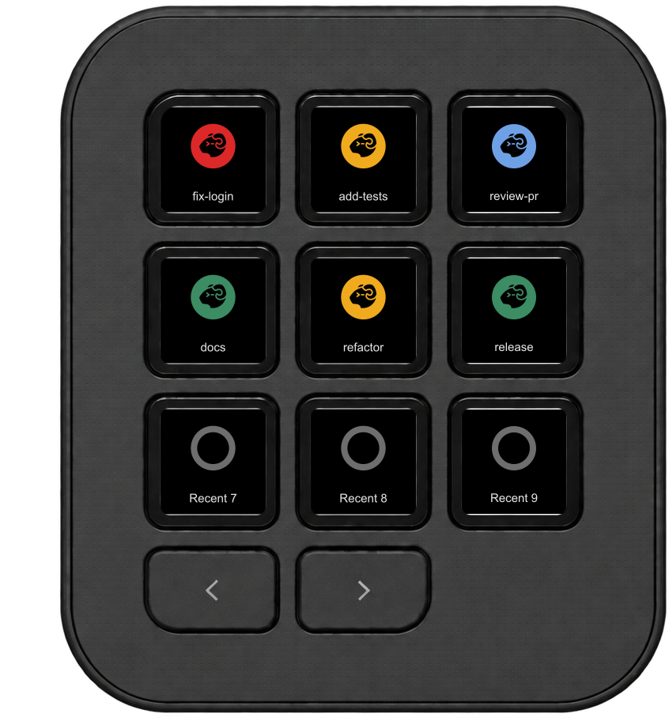
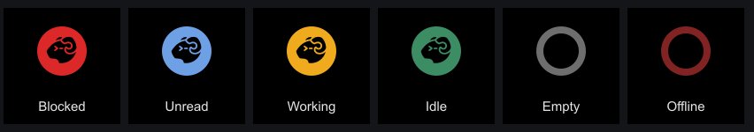
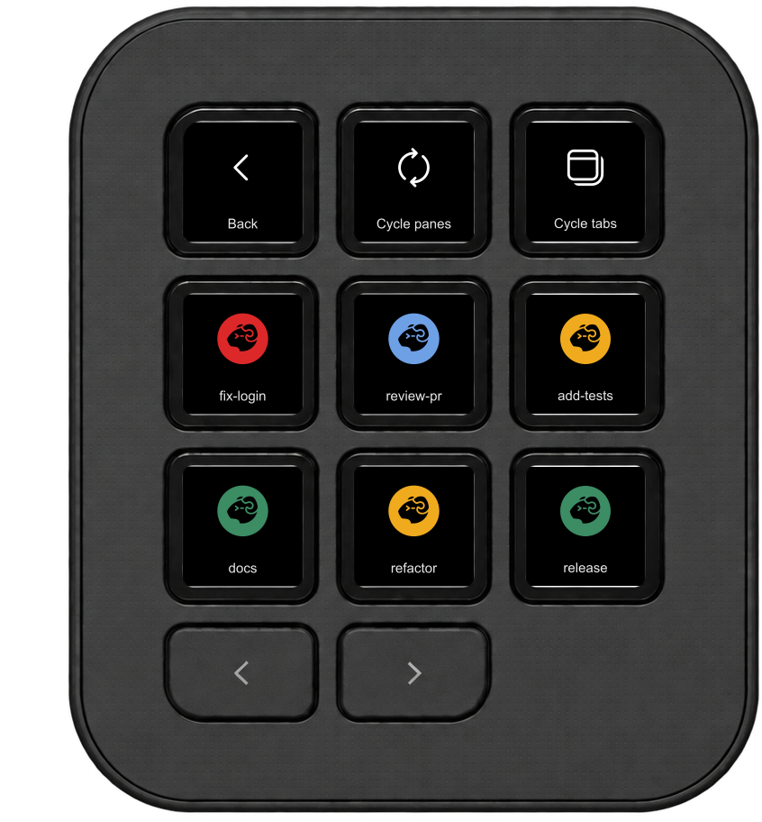
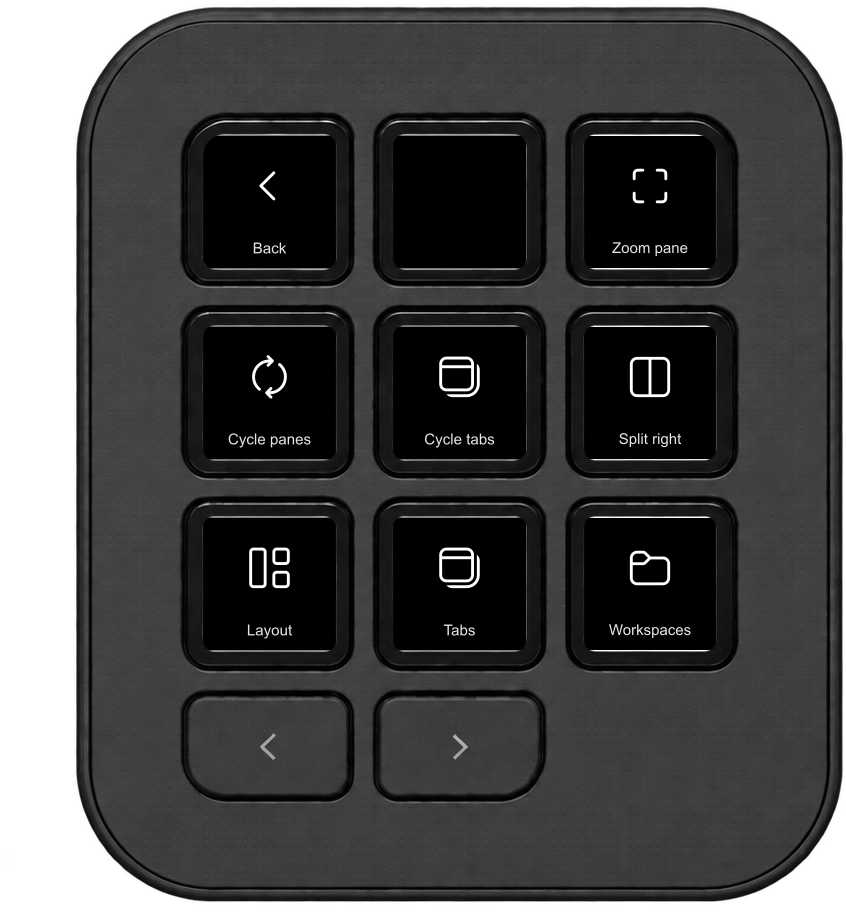
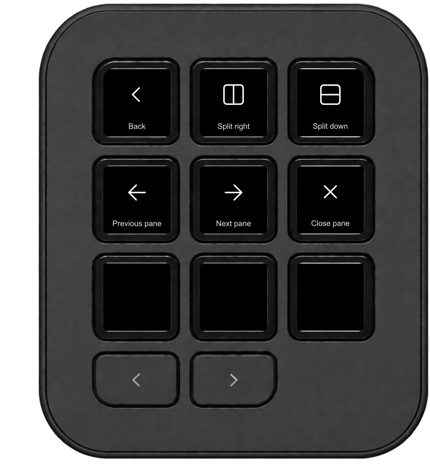

# Herdr TUI Keypad

An agent-first Logitech MX Creative Keypad plugin for [Herdr TUI](https://github.com/herdrdev/herdr), with live status,
one-press focus and navigation.

<p align="center">
  
</p>

> The images are diagrams drawn from the plugin's colors and icons, not photos.

The Agents folder shows Cycle panes and Cycle tabs followed by live agents with
state colors and session titles. Cycle tabs stays within the current workspace.
The folder's own key shows the most urgent agent: blocked, done (unseen),
working, then idle. Ties follow the same recent-state-change order.
Blocked is red, done is blue, working is amber, and idle is green.
Press to focus; hold and then press **Close?** within three seconds to close the
pane. Herdr closes the pane, which stops its running process. The Shortcuts folder
starts with Zoom pane and Cycle panes, followed by Layout, Tabs and Workspaces;
each shortcut is independently assignable.

**Recent Agent 1–9** are individual keys for the agents in recent-state-change
order; press one to focus its pane. **Space 1–9** show each numbered workspace's
status: press to focus the workspace, then press again to cycle panes in its
active tab. Unoccupied slots and an offline server have distinct indicators.

**Close pane** is available under Layout and as an individual action. Hold it,
then press **Close?** within three seconds. The action cancels if the focused
pane or its terminal has changed before confirmation.



| Action | What it does |
|---|---|
| **Recent Agent 1–9** | Shows agents in recent state-change order; press to focus. |
| **Space 1–9** | Shows a workspace's status; press to focus, then cycle its active tab's panes. |
| **Herdr TUI** | Cycle panes, cycle tabs and browse live agents. Hold an agent and confirm to close its pane. |
| **Herdr shortcuts** | Zoom, cycle panes, and open Layout, Tabs or Workspaces. Each shortcut is also assignable separately. |

<p align="center"></p>

<p align="center">
  
  
</p>

Agents are ranked by Herdr's `state_change_seq` when available. This measures
reported state changes, not arbitrary output activity. Older servers fall back to
locally observed status changes. The plugin talks to the local Herdr socket and
raises the configured or detected terminal on agent focus.

## Install

Requires macOS, Herdr TUI 0.9.5, Logi Options+ with Logi Plugin Service 6.4, and an
MX Creative Keypad or compatible Loupedeck device.

1. Download `HerdrKeypad_<version>.lplug4` from the [latest release](https://github.com/robertohuertasm/herdr-tui-logi-plugin/releases/latest).
2. Double-click the package to install it through Logi Options+.
3. Add **Herdr TUI**, **Herdr shortcuts**, or individual actions to the Keypad.

Remove any `HerdrKeypad.link` development link before installing a release.

## Build

Building requires the .NET 10 SDK.

```sh
dotnet test tests/Herdr.Core.Tests
dotnet build src/HerdrKeypad -c Release
dotnet run --project probes/HerdrProbe
```

To regenerate the documentation diagrams, run `npm install --prefix tools`, then
`node tools/render-images.cjs`. The diagrams use the plugin's colors and icons;
the Keypad frame comes from the MIT-licensed reference plugin.
To regenerate the Logi Options+ plugin icon, run `node tools/render-plugin-icon.cjs`.

For a release, set the manifest version and push a matching `vX.Y.Z` tag. GitHub
Actions tests, builds, packs, verifies and attaches the `.lplug4` to a release.
The repository is public. `docs/` contains the GitHub Pages site.

## Verification still needed

- Exercise paging, changing ranks, empty slots and repeated Space presses on the Keypad.
- Verify zoom, navigation and focus against real panes, tabs and workspaces.
- Verify working, done, blocked, offline, empty and stale agent states.
- Herdr offers no conditional `pane.close`: identity is checked immediately
  before close, but the pane can still change between those two requests.

The socket client and terminal detection are adapted from
[niklasberglund/herdr-logi-plugin](https://github.com/niklasberglund/herdr-logi-plugin),
MIT. Its license is included as `LICENSE-REFERENCE` and in the package metadata.
Shortcut icons are [Microsoft Codicons](https://github.com/microsoft/vscode-codicons)
0.0.45, licensed under CC BY 4.0; see `LICENSE-CODICONS`.
The plugin icon and status icon use the [Herdr TUI logo](https://github.com/herdrdev/herdr/blob/v0.9.5/assets/logo.svg)
(the status icon is cropped and recolored), licensed under Apache 2.0; see `LICENSE-HERDR` and
`NOTICE-HERDR`. This independent plugin is not endorsed by the Herdr project.
